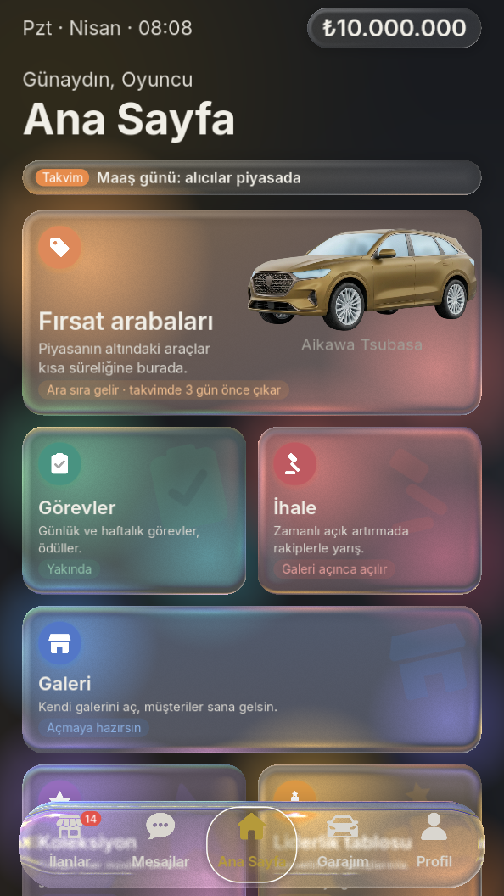
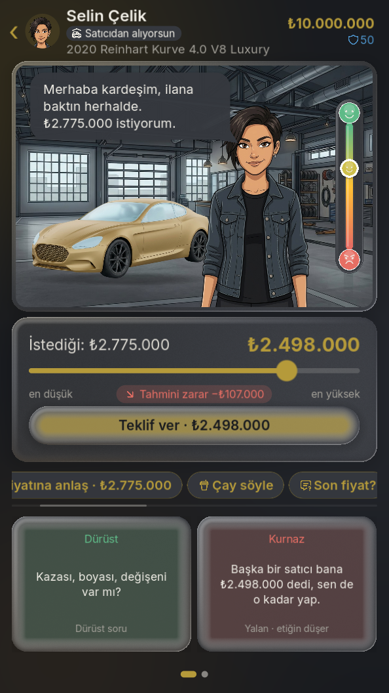
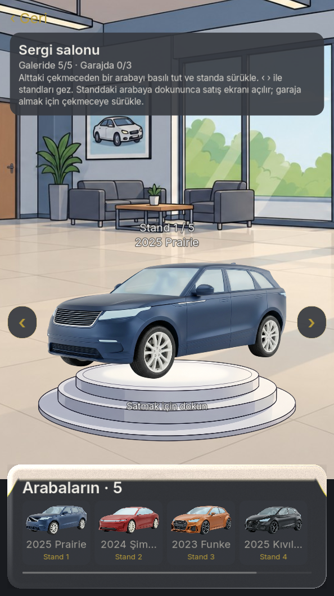
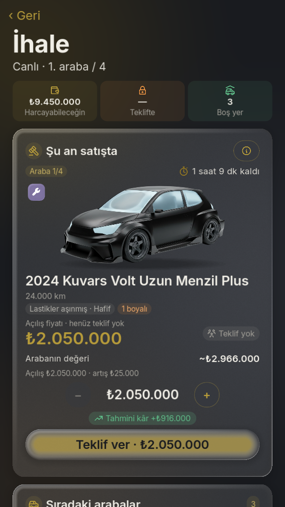

# Al Sat: Araba Ticareti

Türkiye'deki ikinci el araba piyasasını konu alan, **dikey ekranlı mobil galericilik simülasyonu ve RPG'si**. Az sermayeyle başlayan oyuncu ilan bulur, satıcıyı tanır, ekspertiz yaptırır, pazarlık eder, aracı hazırlayıp satar ve sonunda kendi galerisini açar.

> 🇬🇧 **In short:** an offline, portrait-mode mobile car-dealer simulation and RPG set in the Turkish used-car market, written in Godot 4 / GDScript. The core is a bargaining system with hidden seller personalities, a seeded conversation engine, a living market economy and a deterministic, heavily tested rule layer. The project is developed with an AI-assisted workflow (Claude Code + specialist review agents), described in [docs/AI_WORKFLOW.md](docs/AI_WORKFLOW.md).

> **Bu depo bir vitrindir.** Oyunun kaynak kodu ve görselleri özel (private) bir depoda tutulur. Burada projenin tanıtımı, ekran görüntüleri ve geliştirme yöntemi bulunur. Kod incelemesi için iletişime geçebilirsiniz.

  
  
  
  

Ana Sayfa · Pazarlık · Sergi salonu · İhale

## Oyunun fikri

Klasik "Teklif et / Vazgeç" menüsü yok. Oyuncu **kaydırıcıyla kendi teklifini** verir; oyun kabul ihtimalini, satıcının sinirlenme riskini ve olası karşı teklifi gösterir. Hiçbiri kesin garanti değildir: sonucu satıcının gizli kişiliği, aciliyeti, aracın gerçek değeri ve oyuncunun yetenekleri belirler.

Her araç için döngü:

1. **İlanları incele**: fiyat, km, şehir, açıklama.
2. **Satıcıyı tanı**: sohbetten niyet, aciliyet ve pazarlık tarzı okunur.
3. **Aracı kontrol et**: göz kontrolü, test sürüşü, boya ölçer, OBD, tam ekspertiz.
4. **Pazarlık et**: kaydırıcı, öfke göstergesi, dürüst / kurnaz / yetenek / soru hamleleri.
5. **Satın al**: para, araç, ilan ve ilişki tek işlemde (atomik) değişir.
6. **Hazırla ve sat**: sanayide tamir, boya, modifiye. Alıcıya kusuru söylemek oyuncunun etik kararıdır.
7. **Büyü**: XP, yetenek ağacı, itibar, galeri, ihale, kiralama.

Kararların **uzun vadeli sonuçları** vardır: güven, etik, şöhret ve ilişkiler sonraki pazarlıkları etkiler.

## Öne çıkan sistemler

| Sistem | Ne yapar |
|---|---|
| **Pazarlık motoru** | Kaydırıcı teklif, kabul ihtimali, öfke/sabır, karşı teklif tahmini, gizli satıcı kişilikleri |
| **Sohbet motoru** | Çevrimdışı, tohumlu (seeded), tekrar etmeyen satıcı/alıcı diyalogları. Dil modeli yoktur, tamamı yerel kurallarla çalışır |
| **Ekspertiz** | Gizli kusurlar, boya/kaporta haritası, gizli km, torpido gözü evrakları |
| **Fiyat motoru ve piyasa** | Segment bazlı fiyat/talep/arz, piyasa olayları, oyun takvimi, haber bandı |
| **Galeri** | Seviyeler, sergi salonu, gelen satıcılar ve müşteriler, kiralama |
| **İhale** | Rakip firmalarla canlı açık artırma, nakit ve stok sınırları |
| **Kayıt sistemi** | Sürümlü kayıt, otomatik göç (migration), yedekler, çökme sonrası geri dönüş |

## Mühendislik tarafı

- **Godot 4.7, yalnızca GDScript**, statik tipli kod, dikey 1080x1920 ekran.
- **Tek yönlü akış:** UI sistemleri çağırır → sistemler oyun durumunu yazar → kayıt sistemi kaydeder. Oyun kuralı UI'da yaşamaz.
- **Deterministik:** tüm rastgelelik tohumlu üreteçten gelir; testler ve kayıt/yükleme birebir tekrarlanabilir.
- **Para her zaman tam sayı ₺**; ondalık yok, yuvarlama hatası yok.
- **Test:** 840'tan fazla başsız (headless) test: kural, kayıt gidiş-dönüşü, sürüm göçü, saat atlamaları.
- **Ekonomi simülasyonu:** botlarla çok günlük oyun koşturup kâr/seviye dengesini ölçen rapor; denge değişiklikleri ölçülmeden yapılmaz.
- **Yerelleştirme:** tüm oyuncu metni anahtarlı dil dosyasından gelir (2700+ satır, taban dil Türkçe).
- **Ölçek:** yaklaşık 38 bin satır oyun kodu ve yaklaşık 22 bin satır test kodu.

## Durum

Aktif geliştirme. Çekirdek döngü, galeri, ihale, kiralama, takvim, geri dönen araçlar, gizli km, torpido gözü ve yetenek ağacı oynanabilir durumda. Hedef platform Android; oyun tamamen çevrimdışı çalışır.

## Geliştirme yöntemi

Proje, yapay zekâ destekli ama disiplinli bir iş akışıyla geliştirilir: yazılı mühendislik kuralları, fikir → onay → uygulama aşamaları, salt okunur uzman ajanlar, çapraz model incelemesi ve ölçülebilir kalite kapıları. Ayrıntılar: [docs/AI_WORKFLOW.md](docs/AI_WORKFLOW.md).

## Not

Markalar, araç modelleri, siteler ve karakterler kurgusaldır; gerçek kişi ya da kuruluşlara dayanmaz.

© Tüm hakları saklıdır. Bu depodaki metin ve görseller izinsiz kopyalanamaz, çoğaltılamaz veya dağıtılamaz.
